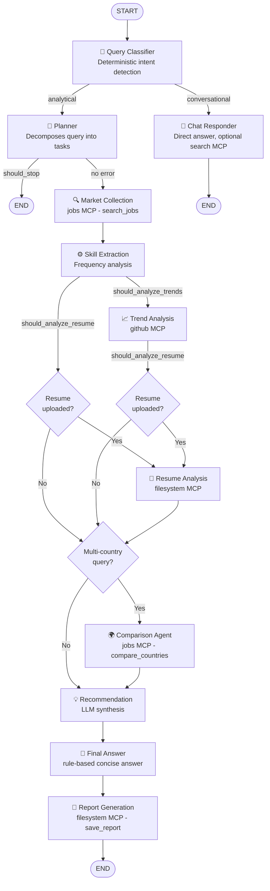

# Job Market Intelligence Agent — Full Architecture Map

## Overview

| Category | Count |
|---|---|
| **MCP Servers** | 5 |
| **Agent Nodes** | 11 |
| **Total MCP Tools** | 13 |
| **Orchestration Engine** | LangGraph (StateGraph) |

---

## 🔌 MCP Servers & Their Tools

### 1. `github` — [github_mcp.py](file:///c:/Users/JainiSolanki/L2_Project/mcp_servers/github_mcp.py)
> GitHub MCP Server — analyzes repository popularity, contributor activity, and technology trends.
> Requires: `GITHUB_TOKEN` in `.env` (optional — 60 req/hr without it)

| Tool | Description | Required Params | Optional Params |
|---|---|---|---|
| `get_repo_stats` | Fetch stats (stars, forks, language, activity) for a specific repo | `repo_path` (e.g. `"langchain-ai/langchain"`) | — |
| `search_repositories` | Search GitHub repos by keyword, sorted by stars | `keyword` | `limit` (default: 10) |
| `get_trending` | Get trending repos for a topic/language using GitHub search API | `topic` | `language` |

---

### 2. `search` — [search_mcp.py](file:///c:/Users/JainiSolanki/L2_Project/mcp_servers/search_mcp.py)
> Search MCP Server — web search via **Tavily API** for job market data, tech articles, salary reports.
> Requires: `TAVILY_API_KEY` in `.env` (free tier: 1,000 calls/month)

| Tool | Description | Required Params | Optional Params |
|---|---|---|---|
| `web_search` | General web search, returns clean structured results | `query` | `max_results` (default: 5) |
| `search_tech_news` | Search for technology news and developer blog posts | `technology` | `recency_days` (default: 30) |
| `search_market_reports` | Search for salary surveys and developer market reports | `role` | `country` |

---

### 3. `filesystem` — [filesystem_mcp.py](file:///c:/Users/JainiSolanki/L2_Project/mcp_servers/filesystem_mcp.py)
> Filesystem MCP Server — controlled access to read resumes and write reports.
> Security: Path traversal protection — only `uploads/`, `reports/`, and `RESUME_UPLOAD_DIR` allowed.

| Tool | Description | Required Params | Optional Params |
|---|---|---|---|
| `read_file` | Read contents of a text file (binary files like PDF/DOCX redirect to parser) | `file_path` | — |
| `list_directory` | List all files in an allowed directory | `directory_path` | — |
| `save_report` | Save a generated report to the `./reports/` directory | `filename`, `content` | — |

---

### 4. `reddit` — [reddit_mcp.py](file:///c:/Users/JainiSolanki/L2_Project/mcp_servers/reddit_mcp.py)
> Reddit MCP Server — developer community sentiment and adoption signal analysis.
> **Optional** — system works without it. Requires: `REDDIT_CLIENT_ID` + `REDDIT_CLIENT_SECRET`
> Monitored subreddits: r/MachineLearning, r/LocalLLaMA, r/dataengineering, r/cscareerquestions, r/Python, etc.

| Tool | Description | Required Params | Optional Params |
|---|---|---|---|
| `search_posts` | Search Reddit posts about a topic across tech subreddits | `query` | `subreddit`, `limit` (default: 10) |
| `get_tech_sentiment` | Analyze community activity & sentiment heuristics for a technology | `technology` | `time_filter` (`week`/`month`/`year`, default: `month`) |

---

### 5. `jobs` — [jobs_mcp.py](file:///c:/Users/JainiSolanki/L2_Project/mcp_servers/jobs_mcp.py)
> Jobs MCP Server — live job posting collection (Adzuna + Arbeitnow) and cross-country comparison.
> Requires: `ADZUNA_APP_ID` + `ADZUNA_APP_KEY` in `.env` (Arbeitnow is key-free)

| Tool | Description | Required Params | Optional Params |
|---|---|---|---|
| `search_jobs` | Collect live job postings for a role/country | `role` | `country`, `max_results` (default: 100) |
| `compare_countries` | Compare a role's job market across countries (volume, salaries, top skills) | `role`, `country_codes` | `max_results` |

---

## 🤖 Agent Nodes (11 Total)

| Agent | File | MCP(s) Used | Runs |
|---|---|---|---|
| **QueryClassifier** | [classifier.py](file:///c:/Users/JainiSolanki/L2_Project/agents/classifier.py) | None (deterministic, no LLM) | Always |
| **ChatResponder** | [chat_responder.py](file:///c:/Users/JainiSolanki/L2_Project/agents/chat_responder.py) | **`search`** (optional web grounding) | Conversational / off-topic queries only |
| **Planner** | [planner.py](file:///c:/Users/JainiSolanki/L2_Project/agents/planner.py) | None (uses LLM directly, with deterministic fallback) | Analytical queries only |
| **MarketCollection** | [market_collection.py](file:///c:/Users/JainiSolanki/L2_Project/agents/market_collection.py) | **`jobs`** (`search_jobs` via registry) | Always (analytical) |
| **SkillExtraction** | [skill_extraction.py](file:///c:/Users/JainiSolanki/L2_Project/agents/skill_extraction.py) | None (processes in-memory data) | Always (analytical) |
| **TrendAnalysis** | [trend_analysis.py](file:///c:/Users/JainiSolanki/L2_Project/agents/trend_analysis.py) | **`github`** (`get_repo_stats` / `get_trending` via registry) | Conditional — trend query or technologies present |
| **ResumeAnalysis** | [resume_analysis.py](file:///c:/Users/JainiSolanki/L2_Project/agents/resume_analysis.py) | **`filesystem`** (`read_file` via registry) | Conditional — only if resume uploaded |
| **ComparisonAgent** | [country_comparison.py](file:///c:/Users/JainiSolanki/L2_Project/agents/country_comparison.py) | **`jobs`** (`compare_countries` via registry) | Conditional — multi-country query |
| **Recommendation** | [recommendation.py](file:///c:/Users/JainiSolanki/L2_Project/agents/recommendation.py) | None (LLM synthesis) | Always (analytical) |
| **FinalAnswer** | [final_answer.py](file:///c:/Users/JainiSolanki/L2_Project/agents/final_answer.py) | None (rule-based, reads state) | Always (analytical) — writes the concise question-aligned `direct_answer` |
| **ReportGeneration** | [report_generation.py](file:///c:/Users/JainiSolanki/L2_Project/agents/report_generation.py) | **`filesystem`** (`save_report` via registry) | Always (analytical) |

---

## 🔄 Orchestration — LangGraph StateGraph

Orchestrated by **LangGraph** via [`graph.py`](file:///c:/Users/JainiSolanki/L2_Project/agents/graph.py) using a `StateGraph` with shared [`GraphState`](file:///c:/Users/JainiSolanki/L2_Project/agents/state.py).

### Execution Flow



### Conditional Routing Logic

| Decision Point | Function | Condition → Route |
|---|---|---|
| After **QueryClassifier** | `route_after_classifier` | `query_intent` in ANALYTICAL_INTENTS → `planner`, else → `chat_responder` |
| After **Planner** | `route_after_planner` | `should_stop == True` → END, else → `market_collection` |
| After **SkillExtraction** | `should_analyze_trends` | Plan has `analyze_trends` task OR technologies present → `trend_analysis`, else → `resume_analysis` |
| After **TrendAnalysis** | `should_analyze_resume` | `state.resume_path` is set → `resume_analysis`, else → `recommendation` |
| After **ResumeAnalysis** | `should_run_country_comparison` | `comparison` task in plan AND countries > 1 → `comparison_agent`, else → `recommendation` |

### Shared State (`GraphState`)

All agents communicate via a single [`GraphState`](file:///c:/Users/JainiSolanki/L2_Project/agents/state.py) TypedDict — like a shared whiteboard:

| Field | Set By | Read By |
|---|---|---|
| `user_query` | Graph entry | QueryClassifier, Planner |
| `query_intent`, `intent_confidence` | QueryClassifier | Graph routing |
| `execution_plan` | Planner | All agents |
| `role`, `country_filter` | Planner | All agents |
| `technologies_to_analyze` | Planner | TrendAnalysis |
| `resume_path` | Graph entry | ResumeAnalysis |
| `job_search_results` | MarketCollection | SkillExtraction, ComparisonAgent |
| `skill_statistics` | SkillExtraction | TrendAnalysis, ResumeAnalysis, Recommendation |
| `salary_data` | SkillExtraction | ReportGeneration |
| `trend_data` | TrendAnalysis | Recommendation, ReportGeneration |
| `comparison_raw` | ComparisonAgent | ReportGeneration |
| `resume_data`, `resume_analysis` | ResumeAnalysis | Recommendation, ReportGeneration |
| `recommendations` | Recommendation | FinalAnswer, ReportGeneration |
| `mcp_calls` | All MCP-calling agents | UI / API |
| `direct_answer` | ChatResponder, FinalAnswer | UI / API |
| `final_report` | ReportGeneration | UI / API |

---

## 🗺️ MCP → Agent Usage Map

Every MCP call is recorded in state as an `MCPCallRecord` (agent, server, tool, arguments, success, summary) and surfaced in the Chainlit UI so the demo can show **exactly which MCP was called for which task**.

| MCP Server | Used By Agent | Tool(s) Called |
|---|---|---|
| `jobs` | MarketCollection | `search_jobs` |
| `jobs` | ComparisonAgent | `compare_countries` |
| `github` | TrendAnalysis | `get_repo_stats`, `get_trending` |
| `filesystem` | ResumeAnalysis | `read_file` (resume parsing) |
| `filesystem` | ReportGeneration | `save_report` |
| `search` | ChatResponder | `web_search` (grounding off-topic answers) |

> [!NOTE]
> `reddit` is registered in the registry and available for planner-directed use, but no agent currently hard-wires calls to it — it is called when the LLM Planner includes it in the execution plan.

---

## 🏛️ Registry Pattern

The [`MCPRegistry`](file:///c:/Users/JainiSolanki/L2_Project/mcp_servers/registry.py) is a **singleton** that:
- **Discovers** all MCPs: `github`, `search`, `filesystem`, `reddit`, `jobs`
- **Routes** calls: `call_tool(server_name, tool_name, args)` or auto-routes with `call_tool_auto_route(tool_name, args)`
- **Lists** all tools in `"server.tool"` dot-notation (e.g. `"github.get_repo_stats"`)
- Accessed via `get_registry()` (lazy-initialized singleton)

**Agent-side pattern** (from `agents/market_collection.py`):

```python
registry = get_registry()
result = await registry.call_tool("jobs", "search_jobs", {...})
mcp_calls.append(MCPCallRecord(agent="market_collection", server="jobs",
                               tool="search_jobs", success=True, ...))
```
